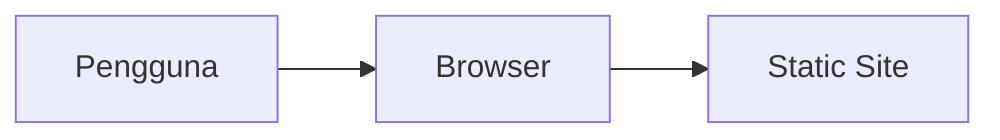

# Myagents Mockup

Myagents Mockup — project oleh Nabil Aulia Dika (dezzorigin).

## Status Proyek

**Dalam pengembangan** _(README ada)_

## 📋 Tech Stack

HTML/CSS/JavaScript

## 🏗️ Arsitektur



## 📁 Struktur Proyek

```
FLOW.md
LICENSE
PRD.md
README.md
mockup-dashboard.html
mockup-flow.html
mockup-landing.html
mockup-v1.html
```

## 🚀 Getting Started

```bash
# Install dependencies
npm install

# Jalankan development server
npm run dev
```

> Untuk project HTML/Python/Go, lihat instruksi di atas atau file konfigurasi.

## 📄 Lisensi

MIT — lihat [LICENSE](./LICENSE).

---
_Dikembangkan oleh **dezzorigin** (Nabil Aulia Dika)._
